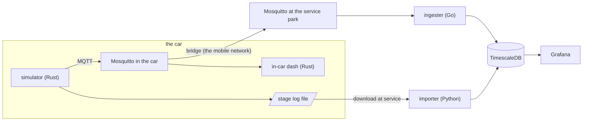

# wrc-telemetry-pipeline

Live telemetry from a (simulated) rally car to a dashboard. Mostly an excuse to find out what happens when the car keeps driving into places with no signal.

Work in progress.

## The problem

A rally stage isn't a circuit. It's 10 to 30 km of closed public road through forests and mountains. Mobile coverage comes and goes. The car drops behind a hill, loses the network for 20 seconds, comes back, and the whole time it kept recording at 50 Hz.

So the pipeline has to handle:

- **gaps**: data from the dead zone arrives late, or (depending on settings) never
- **bursts**: after reconnecting, the car sends everything it buffered at once, on top of the live data
- **duplicates**: retrying means the same sample can arrive twice
- **order**: old samples show up after newer ones

That's what this project is really about. Car sends, dashboard shows, that part is easy.

One thing to be honest about: in WRC, teams aren't allowed live telemetry from the car during an event. The car records everything on its data logger, and the team downloads it at service. Live data during a stage goes to the organiser's safety tracking, not to the team. So this project has two paths:

- **live**: car → MQTT → dashboard, with all the dead zone problems above. Closest to safety tracking and testing.
- **post-stage**: the full logger file, imported after the stage. That's what teams actually work with.

I don't know what real WRC teams run. This is my take on the engineering problem, not a copy of anyone's system.

## How it works



The full diagram, with what each part would be at a real rally, is in [docs/architecture.drawio](docs/architecture.drawio).

- **simulator** drives a stage route from a GPX file (a road used by the Acropolis Rally) and publishes a sample 50 times a second. Speed comes from how tight the road is, the rest (rpm, gear, brake temps) is derived from speed and braking. Like a real data logger, it also writes every sample to a file, one per stage.
- **Mosquitto in the car** is a local broker. The simulator and the dash talk to it, so they never depend on the mobile network. It forwards everything to the service park over a bridge, and queues messages while there's no signal.
- **in-car dash** is the driver's display: gear, rpm with shift lights, warnings for hot brakes or water, and whether the car is online or how much is waiting to be sent. It keeps working in a dead zone, while Grafana at the service park freezes.
- **Mosquitto at the service park** is where all cars arrive. The ingester subscribes to it.
- **ingester** reads from the broker, drops duplicates, writes to the database in batches, and flags things like overheating brakes.
- **importer** reads the stage log files (MDF4 or CSV) after the stage, writes them to the same database marked as logger data, and builds a short report for the stage. At a real rally, service can be as short as 15 minutes, so getting from "data downloaded" to "we know what happened" fast is the whole game.
- **TimescaleDB** is Postgres with time series extras. Plain SQL, and Grafana talks to it out of the box.
- **Grafana** has three views. **Stage analysis**: several cars on the same stage, driver against driver, and where on the road the time is lost. **Live stage**: the car on a map, speed/rpm/temps, online or offline, and an alert when brakes get too hot. **Post-stage**: the live data next to the logger data, so you see exactly what got lost.

## Try it

```bash
docker compose up
```

Grafana is on http://localhost:3000 (admin / admin).

To fake a dead zone, freeze the service park broker for 30 seconds:

```bash
docker compose pause mosquitto-park
docker compose unpause mosquitto-park
```

The bridge drops, the car's broker queues everything, and the dash keeps showing live data. When you unpause, the backlog goes through and the gap on the Grafana dashboard fills in.

(Until milestone 9 there is only one broker, called `mosquitto`, so pause that one instead.)

## The data

One message per sample, JSON:

```json
{
  "car": "car-1",
  "stage": "SS1",
  "seq": 18234,
  "ts": 1763125381123,
  "distance_m": 6412.5,
  "speed_kmh": 142.5,
  "rpm": 7350,
  "gear": 5,
  "throttle_pct": 100,
  "brake_pct": 0,
  "brake_temp_fl_c": 412,
  "brake_temp_fr_c": 405,
  "brake_temp_rl_c": 288,
  "brake_temp_rr_c": 291,
  "coolant_temp_c": 96,
  "boost_bar": 2.4,
  "g_lat": 1.3,
  "g_long": 0.1,
  "lat": 38.2531,
  "lon": 22.1043
}
```

`ts` is the car's own clock in ms, `seq` counts up by one per sample. Both matter, see below. `distance_m` is how far into the stage the car is. Drivers are compared at the same point on the road, not at the same second, so this is what the stage analysis is built on. Units are in the names, so nobody has to guess whether speed is km/h or m/s.

The schema is in [db/init/001_schema.sql](db/init/001_schema.sql). It runs automatically the first time the database starts.

| Topic | What |
|---|---|
| `rally/<car>/telemetry` | the samples, QoS 1 |
| `rally/<car>/status` | `online` / `offline`, retained, also the last will |

## MQTT in two minutes

While building this I learned, and remembered, a lot of terms, so here they are. A reminder for you and for me as well:

- **Broker**: the server in the middle. Nobody talks to each other directly, everyone talks to the broker.
- **Topic**: a name like `rally/car-1/telemetry`. You publish to a topic, others subscribe to it. Wildcards work, `rally/+/telemetry` means every car.
- **QoS 0**: at most once. Send and forget. Fastest, but if it's lost, it's lost.
- **QoS 1**: at least once. The sender keeps resending until the broker says "got it". Nothing is lost, but if the "got it" gets lost, the same message arrives twice.
- **QoS 2**: exactly once, using a 4-step handshake. Safe but slow, overkill for 50 Hz data.
- **Keep alive**: client and broker ping each other every few seconds. If the pings stop, the connection is considered dead.
- **Last will**: a message the client leaves with the broker when it connects. If the client disappears without saying goodbye, the broker publishes it. That's how the dashboard knows a car went offline.
- **Retained**: the broker keeps the last message on a topic and gives it to anyone who subscribes later. A new dashboard sees the car's status right away instead of waiting.
- **Bridge**: one broker connected to another, forwarding messages. If the link drops, it queues QoS 1 messages and sends them when it's back. That's how the car's broker talks to the service park.

## Dealing with dead zones

1. **The car stamps everything.** Each sample carries the car's time and a sequence number. Charts use the car's time, not the arrival time, so late data lands where it belongs.
2. **QoS 1 and dedup.** Telemetry goes as QoS 1, so nothing gets lost once the car sends it. Duplicates are dropped in the database: `(car, seq)` is the primary key and inserts use `ON CONFLICT DO NOTHING`.
3. **Buffer in the car, done twice.** The first version has its own ring buffer in the simulator, a few minutes' worth, oldest dropped first when full. On reconnect it sends live samples first and the backlog behind them, so the dashboard stays live while the gap fills in. The second version moves buffering to the broker in the car and its bridge. Less code, but the bridge sends in order, so after a long gap live data waits behind the backlog. Comparing the two is part of the point.
4. **Batch writes.** The ingester writes every 100 ms or every 500 rows, whichever comes first. A 30 s burst is 1,500 samples per car, and 1,500 single inserts would choke.
5. **Count what's missing.** Missing sequence numbers mean lost data. The ingester counts them, so "we lost 0.3% on stage 4" is a query, not a guess.
6. **The logger has the full truth.** After the stage, the importer loads the complete log file. Live and logger data sit side by side, so you can check whether the live path really lost nothing.

## Why these tools

- **MQTT, not HTTP.** Small messages, one long-lived connection, and it was built for bad networks. HTTP would mean a full request per sample.
- **Rust for the simulator.** The car side would run on a small box inside the car, where you want predictable memory use and no garbage collector. Also, I wanted to learn Rust, and this is a small, self-contained piece to learn it on.
- **A broker inside the car.** Everything in the car talks to something that is always there. Only the bridge deals with the bad network.
- **Rust for the dash too.** Same box, same language. A terminal UI (ratatui) is enough to show the idea.
- **Go for the ingester.** Goroutines make "read from MQTT, batch, write to DB" simple, the libraries are solid, and it's what most cloud tooling is written in.
- **Python for the importer.** MDF4 (ASAM MDF) is the standard file format for measurement data in automotive, and Python has a good library for it (asammdf).
- **No Kafka (yet).** One consumer and one database don't need it. Kafka starts to make sense when several services read the same stream or you want to replay a whole rally. Maybe later.

## Latency

What I measure: the time between the simulator creating a sample and that row being in the database. Everything runs on one laptop, so both ends use the same clock.

What I don't measure:

- **Grafana.** Dashboards refresh on a timer measured in seconds, so "ms to the screen" doesn't mean much.
- **A real mobile network.** On its own it adds tens to hundreds of ms. These numbers are the pipeline's own overhead, nothing more.

| Cars | Rate | Msg/s | p50 | p95 | p99 |
|---|---|---|---|---|---|
| 1 | 50 Hz | 50 | tbd | tbd | tbd |
| 5 | 50 Hz | 250 | tbd | tbd | tbd |
| 20 | 50 Hz | 1,000 | tbd | tbd | tbd |

## Layout

```
simulator/      rust, the car (live samples + stage log files)
dash/           rust, the driver's display
ingester/       go, mqtt -> timescaledb
importer/       python, stage log files -> timescaledb
db/             schema
mosquitto/      broker config (car and service park)
grafana/        dashboards and datasource, provisioned on startup
docs/           architecture and database diagrams (draw.io)
docker-compose.yml
```

## Roadmap

The post-stage path comes first, because that's what teams actually work with. The live and edge parts come after.

- [x] 1. docker compose: Mosquitto, TimescaleDB, Grafana
- [x] 2. database schema: rallies, stages, cars and drivers, samples, gaps, car status
- [ ] 3. simulator: GPX route, car model with driver profiles, 50 Hz over MQTT, plus a log file per stage
- [ ] 4. ingester: MQTT to TimescaleDB in batches
- [ ] 5. first dashboard: the car moving on the map
- [ ] 6. importer: stage log files into the database
- [ ] 7. stage analysis: several cars on the same stage, driver against driver, an automatic report per stage
- [ ] 8. dead zones: own ring buffer, dedup, gaps, last will, live against logger dashboard
- [ ] 9. bonus edge: broker in the car and the in-car dash, buffering moves to the bridge, compared with 8
- [ ] 10. measure latency, finish this README

## Limitations

- The car physics are rough. Good enough to look like a rally car on a chart, not for engineering decisions.
- Everything is on one machine. No real network, no real outages, just a paused container.

## A few words from me

I'm Panos, a software engineer and a huge WRC fan. I have started building projects like these for fun and to learn. Issues and PRs are welcome.

## Ideas that I have for next

- Kafka between the broker and the ingester, and replaying a whole stage.
- ClickHouse instead of TimescaleDB, to compare.
- Run the ingester on k3s on a small box, like a "service park" setup.
- Terraform for an AWS version.
